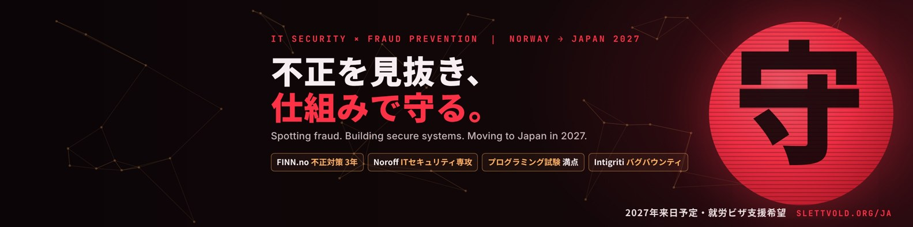

## Hi, I'm Tommy 👋 ／ スレットボルド・トミーです

IT security and fraud prevention, from Norway, moving to Japan in 2027. 
ノルウェー出身。IT セキュリティと不正対策を軸に、2027 年の来日に向けて準備しています。

- 🛡️ **3 years of fraud prevention** at FINN.no, Norway's largest online marketplace: scams, fraudulent listings, account takeovers
- 🎓 **Network & IT Security** at Noroff (graduating March 2027), 70/70 on the programming exam
- 🐞 **Bug bounty** research on Intigriti since 2025
- 🇯🇵 **Japanese**: studying every day, and building my own app to do it

## What I build ／ 個人開発

| Project | What it is | Stack |
| --- | --- | --- |
| [**Oni Dojo 鬼道場**](https://slettvold.org/onidojo/) | Japanese learning app, kana to JLPT N1, for Windows and Android. Server-side purchase verification, row-level security, signed content updates, no tracking. | JavaScript, Electron, Capacitor, Python, Supabase (PostgreSQL), GitHub Actions |
| [**Rireki Studio**](https://slettvold.org/rireki/) | Free 履歴書 and 職務経歴書 maker for foreigners job hunting in Japan. No account; your data never leaves the browser. | JavaScript, static site with a strict CSP |
| [**slettvold.org**](https://slettvold.org/ja/) ([source](https://github.com/SlettvoldSec/Slettvold-Website)) | My portfolio in English and Japanese. Static, fast, no trackers. | Python build, HTML/CSS |
| **LNXE Corp** (school project) | Designed and hardened a virtualised company network: Ubuntu servers, Nginx, UFW, SSH key auth, rsync backups with restore tests, risk analysis, RTO/RPO. | VMware, Ubuntu Server, Nginx, UFW, rsync |

## Skills ／ スキル

`Network security` `Fraud investigation` `Linux` `Ubuntu` `Nginx` `Firewalls (UFW)` `SSH` `VMware` `Python` `JavaScript` `PostgreSQL` `Supabase` `Git` `GDPR` `OSINT` `Web application security` `Zendesk`

## Looking for ／ 希望職種

SOC and security operations, fraud prevention / trust & safety, IT support and 社内SE, in Japan from 2027. 
SOC・セキュリティ運用、不正対策、IT サポート、社内 SE。

📫 [LinkedIn](https://www.linkedin.com/in/tommyandreslettvold/) · [slettvold.org/ja](https://slettvold.org/ja/) · tommy@slettvold.org
